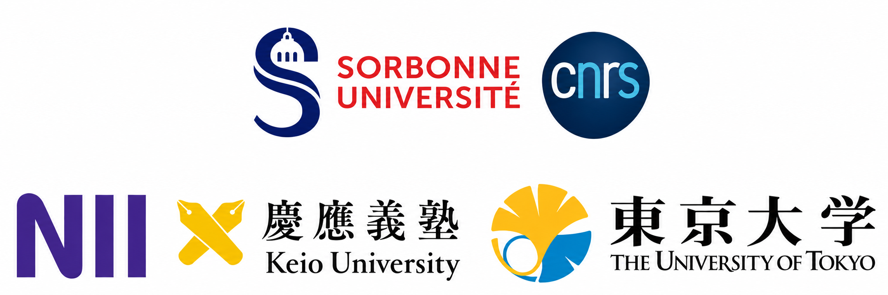

The Japanese-French Quantum Information 2026 Workshop is a workshop of the [Japanese-French Laboratory for Informatics (JFLI)](https://jfli.cnrs.fr). The JFLI is an International Research Laboratory (IRL 3527) formed by two French institutions ([CNRS](https://www.cnrs.fr/en) and [Sorbonne University](https://www.sorbonne-universite.fr/)) and three Japanese institutions ([NII](https://www.nii.ac.jp/en/), [The University of Tokyo](https://www.u-tokyo.ac.jp/en/), and [Keio University](https://www.keio.ac.jp/en/)). The main goal of the workshop is to strengthen collaborations and create new connections between JFLI members in Japan and France who are working on quantum information science.

The workshop will take place in Tokyo on 2–4 December 2026 (Wednesday to Friday) at the [National Institute of Informatics (NII)]({{ '/venue/' | relative_url }}), at [2-1-2 Hitotsubashi, Chiyoda-ku, Tokyo 101-8430, Japan]({{ '/venue/' | relative_url }}).

The workshop is organised by [Jessica Bavaresco](https://jessicabavaresco.github.io/) and [Marco Túlio Quintino](https://mtcq.github.io/), with funding from the [Japanese-French Laboratory for Informatics (JFLI)](https://jfli.cnrs.fr/) and the [Quantum Information Center Sorbonne (QICS)](https://qics.sorbonne-universite.fr/en), and endorsed by the [Global Research Center for Quantum Information Science](https://quantum.nii.ac.jp/) of the [National Institute of Informatics](https://www.nii.ac.jp/).

Information about the previous edition is available on the [JFQI 2023 website](https://jfqi2023.github.io/).

<h2 class="h5 font-weight-bold">Confirmed Speakers</h2>

- [Armando Angrisani](https://sites.google.com/view/angrisani) (University of Copenhagen → DIENS, CNRS, École normale supérieure)
- [Polina Chernyshova](https://www.lip6.fr/actualite/personnes-fiche.php?ident=D2890&LANG=en) (LIP6, CNRS, Sorbonne University)
- [Philippe Codognet](https://www.lip6.fr/actualite/personnes-fiche.php?ident=P1167) (JFLI, CNRS, Sorbonne University)
- [Zoe G. del Toro](https://zoegdt.github.io/) (LIP6, CNRS, Sorbonne University)
- [Alex B. Grilo](https://abgrilo.github.io/) (LIP6, CNRS, Sorbonne University)
- [Michal Hajdušek](https://quantum.keio.ac.jp/employees/michal-hajdusek/) (Keio University)
- [Tadashi Kadowaki](https://dblp.org/pid/36/7606.html) (AIST)
- [Masato Koashi](https://www.u-tokyo.ac.jp/focus/en/people/people003544.html) (The University of Tokyo)
- [Ravi Kunjwal](https://ravikunjwal.com) (LIS, CNRS, Aix-Marseille University)
- [Jonas Landman](https://scholar.google.com/citations?user=itqTkSwAAAAJ&hl=fr) (DIENS, Inria, CNRS, École normale supérieure)
- [Kristin S. Lien](https://www.lip6.fr/actualite/personnes-fiche.php?ident=I2142&LANG=en) (LIP6, CNRS, Sorbonne University)
- [Eliott Mamon](https://www.lip6.fr/actualite/personnes-fiche.php?ident=D2713) (LIP6, CNRS, Sorbonne University)
- [Mehdi Mhalla](https://membres-lig.imag.fr/mhalla/) (LIG, CNRS, University Grenoble Alpes)
- [Pérola Milman](https://mpq.u-paris.fr/annuaire/milman-perola/) (MPQ, CNRS, University Paris Cité)
- [Mio Murao](https://www.s.u-tokyo.ac.jp/en/people/murao_mio/) (The University of Tokyo)
- [Ion Nechita](https://ion.nechita.net) (LPT, CNRS, University of Toulouse)
- [Kae Nemoto](https://www.oist.jp/research/research-units/qist/kae-nemoto) (OIST, NII)
- [Romain Piron](https://rpiron.github.io) (NII)
- [Takahiko Satoh](https://quantum.keio.ac.jp/employees/takahiko-satoh/) (Keio University)
- [Akihito Soeda](https://www.nii.ac.jp/en/faculty/informatics/soeda_akihito/) (NII)
- [Ivan Šupić](https://quantumsupic.github.io) (LIG, CNRS, University Grenoble Alpes)
- [Ryuji Takagi](https://ryujitakagi.wordpress.com/) (The University of Tokyo)
- [Nicolas Treps](https://www.lkb.fr/multimodequantumoptics/about-the-team/people/nicolas-treps/) (LKB, CNRS, Sorbonne University)
- [Rodney van Meter](https://quantum.keio.ac.jp/employees/rodney-van-meter/) (Keio University)
- [Carlos Vieira](https://www.lip6.fr/actualite/personnes-fiche.php?ident=I2172) (Unicamp & LIP6, CNRS, Sorbonne University)
- [Hayata Yamasaki](https://www.hayatayamasaki.com/) (The University of Tokyo)
- [Satoshi Yoshida](https://sy3104.github.io) (The University of Tokyo)

**Organization:** [Jessica Bavaresco](https://jessicabavaresco.github.io/) and [Marco Túlio Quintino](https://mtcq.github.io/)  
**Local organization support:** [Akihito Soeda](https://www.nii.ac.jp/en/faculty/informatics/soeda_akihito/)  
**Local admin support:** Toshie Sakakihara   
<!-- Website: [Marco Túlio Quintino](https://mtcq.github.io/)   -->
Contact emails: [jessica.bavaresco@lip6.fr](mailto:Jessica.Bavaresco@lip6.fr) and [marco.quintino@lip6.fr](mailto:Marco.Quintino@lip6.fr)

**Funding:**

  
  

This workshop is supported by the [Japanese-French Laboratory for Informatics (JFLI)](https://jfli.cnrs.fr). 
This workshop is supported by the programme d'investissements d’excellence IDEX of the Alliance Sorbonne Université through the [Quantum Information Center Sorbonne (QICS)](https://qics.sorbonne-universite.fr/en).

**The JFLI is a partnership of:**

{: .img-fluid }

**Endorsement:**

  
  

This event is endorsed by the [Global Research Center for Quantum Information Science](https://quantum.nii.ac.jp) of the [National Institute of Informatics](https://www.nii.ac.jp).
